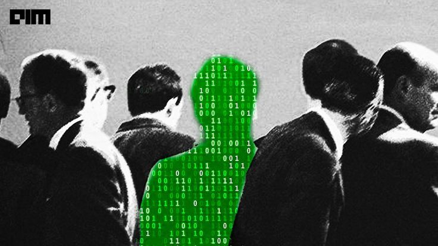

<h2>&nbsp; About Me</h2>

Meu nome é **Matheus Cortes**, tenho 18 anos e sou estudante de **Engenharia de Software** (2º período).

Sempre tive grande interesse por tecnologia e curiosidade em entender como as coisas funcionam por trás do que usamos no dia a dia. Busco constantemente evoluir meus conhecimentos, fortalecer meu raciocínio lógico e desenvolver habilidades que me permitam criar soluções eficientes, acreditando que **dedicação, disciplina e aprendizado contínuo** são essenciais para construir uma carreira sólida na área de tecnologia.

> Desenvolvedor Front-End | React & Next.js | Python | Estudante de Cybersecurity (Red Team)

<h2>&nbsp; Socials</h2>

<h2>&nbsp; Tech Stack</h2>

  

